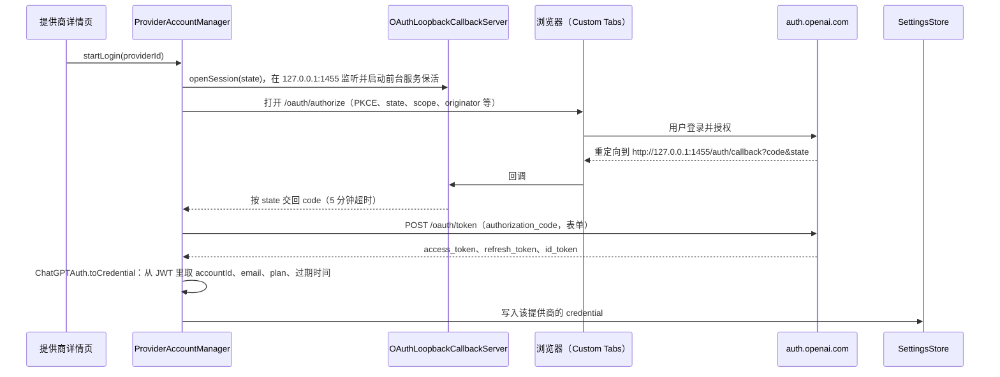
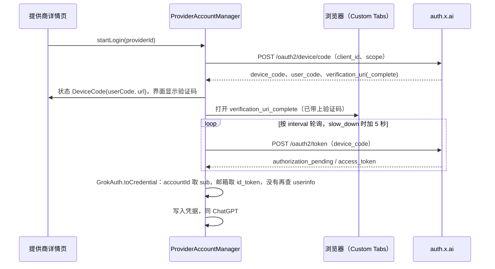
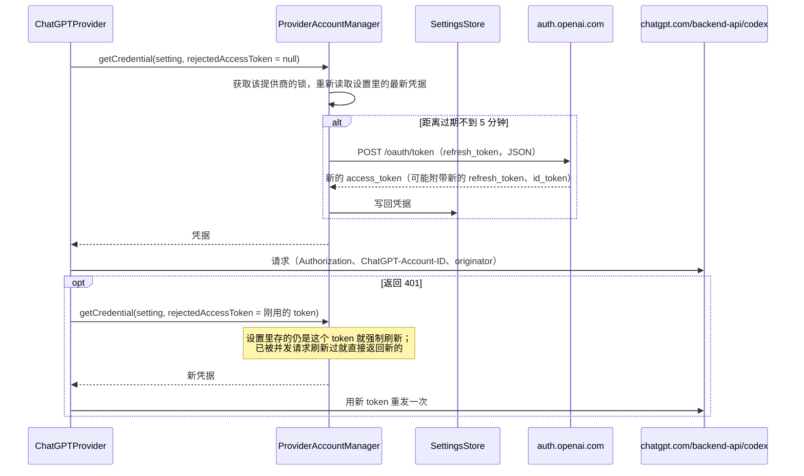

# ai 模块

## Provider 身份验证

提供商按凭据的来源分成两类：

- **API Key 类**：`ProviderSetting.ApiKey` 的子类，即 `OpenAI` / `Google` / `Claude`。凭据（API Key、Vertex 服务账号）由用户填写，
  请求地址 `baseUrl` 也由用户填写，可以指向官方接口或任意兼容的中转。
- **账号类**：`ProviderSetting.Account` 的子类，目前有 `ProviderSetting.ChatGPT` 和 `ProviderSetting.Grok`。凭据只能通过账号登录（OAuth）获得，
  请求地址写死在代码里。

ai 模块只负责把凭据放进请求。账号类凭据的登录、刷新和持久化在 app 层，通过 `AccountCredentialProvider` 注入进来；
ai 模块不接触设置存储，也不发起授权流程。

### 概念

| 概念                         | 位置                                     | 说明                                                                                  |
|----------------------------|----------------------------------------|-------------------------------------------------------------------------------------|
| `ProviderSetting`          | `provider/ProviderSetting.kt`          | 一个提供商的完整配置，随设置持久化。按**协议**区分类型，同一协议的不同厂商（官方、各家中转）是同一类型的不同实例                       |
| `ProviderSetting.ApiKey`   | 同上                                     | API Key 类提供商的公共父类，持有 `apiKey`、`baseUrl` 和 `quotaQuery`                                     |
| `ProviderSetting.Account`  | 同上                                     | 账号类提供商的公共父类，持有 `credential: OAuthCredential?`（`null` 表示未登录），只能通过 `withCredential` 替换 |
| `OAuthCredential`          | 同上                                     | 登录得到的凭据，见下表。`toString()` 会遮住 token                                                 |
| `AccountCredentialProvider` | `provider/AccountCredentialProvider.kt` | 由 app 层实现、经 `ProviderManager` 构造参数注入。Provider 每次发请求前向它要可用的凭据                         |
| `KeyRoulette`              | `util/KeyRoulette.kt`                  | API Key 类在多个 key 之间轮换                                                              |
| `customHeaders`            | `ProviderSetting` / `TextGenerationParams` | 用户自定义请求头。请求级的来自助手和模型，同名时覆盖提供商级的                                                   |
| `Model.providerOverwrite`  | `provider/Model.kt`                    | 单个模型改用另一份提供商配置。它是**独立副本**，自带凭据，不随所属提供商变化                                         |
| `ProviderQuota`            | `provider/ProviderQuota.kt`            | `Provider.getQuota` 的返回值，按语义分类型：`Balance`（余额）、`UsageLimits`（订阅用量窗口）                     |
| `QuotaQuery`               | 同上                                     | API Key 类的自定义额度查询：URL、请求头（可引用 `{{baseUrl}}`、`{{apiKey}}`）和取值表达式                         |

`OAuthCredential` 的字段：

| 字段             | 说明                                         |
|----------------|--------------------------------------------|
| `accessToken`  | 放进 `Authorization: Bearer` 的 token          |
| `refreshToken` | 用于换新的 access token。按只能用一次处理（ChatGPT 每次刷新都会轮换），刷新响应不带新的就沿用旧的 |
| `expiresAt`    | access token 的过期时间（毫秒时间戳），`0` 表示未知，未知时不主动刷新   |
| `accountId`    | 厂商侧的账号或工作区 ID。ChatGPT 的请求要带上它；Grok 是 token 的 `sub`，只用于区分账号 |
| `email`、`plan` | 只用于界面展示                                    |

### API Key 类

| 类型                     | 鉴权方式                                                                 |
|------------------------|----------------------------------------------------------------------|
| OpenAI（Chat Completions、Responses） | `Authorization: Bearer <key>`                                         |
| Claude                 | `x-api-key: <key>`                                                    |
| Google（Gemini API）     | `x-goog-api-key: <key>`                                               |
| Google（Vertex，API Key） | 查询参数 `key=<key>`                                                     |
| Google（Vertex，服务账号）    | `Authorization: Bearer <access token>`，由 `ServiceAccountTokenProvider` 换取 |

- **多 key 轮换**：`apiKey` 可以填多个，以空白、换行或逗号分隔。`KeyRoulette.lru` 优先选从没用过的 key，否则选最久没用的；
  使用记录按提供商 id 区分，存在 `cacheDir/lru_key_roulette.json`，一天后过期。服务账号不参与轮换。
- **Vertex 服务账号**：用服务账号私钥签一个 JWT，通过 `urn:ietf:params:oauth:grant-type:jwt-bearer` 向
  `oauth2.googleapis.com` 换取 1 小时有效的 access token，按「账号 + scope」缓存在内存里，过期前 5 分钟重新获取。不落盘。
- **请求头顺序**：先放自定义请求头，再追加鉴权头。
- **额度查询**：由用户配置 `QuotaQuery`，鉴权头也写在它的 `headers` 里（默认值按类型给），
  `{{apiKey}}` 和对话请求一样从多个 key 里取一个。它会把 key 发往用户填的地址，和用户自填 `baseUrl` 是同一性质。
  变量只开放 `baseUrl` 和 `apiKey`，服务账号私钥等字段引用不到。

### 账号类

#### 设计原则

1. **地址由类型决定**。账号类没有 `baseUrl` 和 `apiKey` 字段，Provider 只会把 token 发往代码里写死的地址。
   用户能修改的只有名称、启用状态、模型和自定义请求头；鉴权头在自定义头之后用 `header()` 覆盖写入，自定义头也替换不了它。
   额度查询同理：账号类没有 `QuotaQuery`，查询地址写死在 Provider 里。
   所以 token 不可能被配置发往第三方地址，这是用独立子类而不是给 `ProviderSetting.OpenAI` 加一个凭据字段的原因。
2. **凭据只由 app 层的 `ProviderAccountManager` 写入**。界面编辑、导入、分享都不能改动或带出凭据，见[凭据的写入和去向](#凭据的写入和去向)。
3. **按提供商串行刷新**。refresh token 只能用一次，两个请求同时刷新会让其中一个拿着已作废的 refresh token 失败，
   所以刷新在每个提供商自己的锁里进行，拿到锁后重新读取设置里的最新凭据再决定要不要刷新。

#### 登录

以 ChatGPT 为例，协议参数与 Codex CLI 一致（`client_id`、回调地址都是 Codex CLI 在 OpenAI 授权服务器上注册的，必须原样使用）：

Grok 用设备码登录（RFC 8628），协议参数与 Grok CLI 一致，不需要本地回调：

- 登录状态通过 `ProviderAccountManager.loginStatus` 暴露给界面：进行中是 `Authorizing`，设备码登录等待确认时是
  `DeviceCode(userCode, verificationUrl)`，失败是 `Failed(message)`，成功或取消后移除。
- JWT 只解码 payload、不校验签名：token 直接来自授权服务器的 HTTPS 响应。
- 授权和刷新请求走应用的 `OkHttpClient`，会使用设置里的代理。

#### 发请求与刷新

- 401 重试由 OkHttp 的 `Authenticator`（`providers/AccountAuth.kt` 的 `AccountTokenAuthenticator`）完成，
  流式、非流式、模型列表和额度查询请求都覆盖到。`configureAccountAuth` 写入 `Authorization: Bearer`，各 Provider 只补充自己的额外鉴权头，
  重试时用新凭据重写同一组头。
  它通过请求上的 tag 认出账号类请求，每个请求最多重试一次。
- 刷新失败（网络错误、refresh token 失效等）时抛出「请重新登录」的错误，但**不清除凭据**：临时的网络问题不应该把用户登出。
  重新登录会直接覆盖旧凭据。
- 未登录时 `getCredential` 直接抛错。

#### 凭据的写入和去向

| 场景                    | 处理                                                                                             |
|-----------------------|------------------------------------------------------------------------------------------------|
| 登录、刷新、退出登录            | `ProviderAccountManager` 通过 `SettingsStore.update` 只替换该提供商的 `credential`                       |
| 设置页保存提供商              | 用 `preserveCredential` 保留设置里的最新凭据。编辑期间后台可能刷新过 token，整份写回会用旧凭据覆盖已轮换的 refresh token            |
| 分享 / 二维码导入            | 编码和解码时都去掉凭据；账号类提供商不显示分享按钮                                                                    |
| 模型级提供商覆盖              | 账号类提供商不提供这个选项，否则凭据会被复制成一份不会刷新的副本                                                           |
| 在设置页切换提供商类型（只用于模型级覆盖） | 从账号类转成 API Key 类时不带凭据，地址取目标类型的默认值                                                            |
| 备份、WebDAV/S3 同步       | 和 API Key 一样随设置一起保存。恢复到另一台设备后两边共用同一个 refresh token，任何一边刷新都会让另一边失效，需要重新登录                     |
| Web 端事件流              | 和 API Key 一样包含在推送的完整设置里                                                                        |

#### ChatGPT 的请求约定

地址固定为 `https://chatgpt.com/backend-api/codex`，协议是 Responses API，但和 `api.openai.com` 有几处不同，详见 `ChatGPTProvider`。
请求体的差异用 `CODEX_CAPABILITIES`（`ResponseProviderCapabilities`）表达，由 `ResponseAPI` 直接生成：

- 鉴权头：`Authorization: Bearer <accessToken>`、`ChatGPT-Account-ID: <accountId>`、`originator: codex_cli_rs`；
- `POST /responses` 只支持流式，`store` 必须为 false；system 提示以 `developer` 消息放在 `input` 开头，不使用 `instructions`；
  不接受 `max_output_tokens`、`temperature`、`top_p`；总是请求 `reasoning.encrypted_content`，会话 ID 作为 `prompt_cache_key`；
- `GET /models?client_version=<版本>` 返回 Codex 可用的模型，结果按客户端版本过滤；
- 订阅用量走 `GET https://chatgpt.com/backend-api/wham/usage`（不在 `/codex` 下），取 `rate_limit` 的
  `primary_window`、`secondary_window`（通常是 5 小时和一周），返回 `ProviderQuota.UsageLimits`；
- 流式响应不带 `Content-Type`，依赖 common 模块里放宽了这项检查的 SSE 实现（`me.rerere.common.http.sse.newEventSource`）。

#### Grok 的请求约定

SuperGrok 订阅，参照 can1357/oh-my-pi 的 xai-oauth，详见 `GrokProvider`：

- 对话走 `https://api.x.ai/v1/responses`，鉴权头只有 `Authorization: Bearer <accessToken>`；带 `x-grok-conv-id: <sessionId>` 命中提示缓存；
- 请求体（`GROK_CAPABILITIES`）：system 提示以 `system` 消息放在 `input` 开头；不发 `reasoning.summary`；`reasoning.effort` 只有 low/medium/high，
  只发给模型目录里声明了推理档位的模型；总是请求 `reasoning.encrypted_content`，`store=false` 时多轮推理靠它接上；
- 模型目录合并 `https://cli-chat-proxy.grok.com/v1/models-v2`（Grok CLI）和 `https://api.x.ai/v1/models`，两边都有的以前者为准，
  过滤掉图片、语音等非对话模型；
- 额度查 `https://cli-chat-proxy.grok.com/v1/billing`：先查 `?format=credits` 的按周额度，统一计费账号再查不带参数的按月额度；
- `cli-chat-proxy.grok.com` 上的请求额外带 `X-XAI-Token-Auth: xai-grok-cli`，和官方 CLI 一致。

### 代码分布

| 模块     | 文件                                                       | 职责                                                                       |
|--------|----------------------------------------------------------|--------------------------------------------------------------------------|
| ai     | `provider/ProviderSetting.kt`                            | `OAuthCredential`、`ApiKey`、`Account`、`ChatGPT`、`Grok`、`supportsBuiltInSearch` |
| ai     | `provider/AccountCredentialProvider.kt`                  | 凭据接口                                                                     |
| ai     | `provider/ProviderQuota.kt`、`provider/QuotaQueryRunner.kt` | 额度类型、自定义查询的配置和执行                                                       |
| ai     | `provider/ProviderManager.kt`                            | 注入 `AccountCredentialProvider`，按类型分发 Provider                              |
| ai     | `provider/providers/AccountAuth.kt`                      | 账号类请求的鉴权头和 401 重试                                                      |
| ai     | `provider/providers/chatgpt/ChatGPTProvider.kt`          | Codex 后端适配、订阅用量                                                         |
| ai     | `provider/providers/grok/GrokProvider.kt`                | xAI Responses 适配、模型目录合并、SuperGrok 额度                                     |
| ai     | `util/KeyRoulette.kt`                                    | 多 key 轮换                                                                 |
| ai     | `provider/providers/google/vertex/ServiceAccountTokenProvider.kt` | Vertex 服务账号换 token                                                      |
| oauth  | `OAuthHttpClient.kt`                                     | PKCE、授权地址、授权码换 token、设备码授权和轮询、刷新（表单或 JSON）。MCP 的 OAuth 也用它            |
| oauth  | `OAuthLoopbackCallbackServer.kt`、`OAuthCallbackForegroundService.kt` | 本地回调服务器，按 state 分发回调；等待回调期间用前台服务保活                                   |
| app    | `data/ai/account/ChatGPTAuth.kt`、`GrokAuth.kt`、`Jwt.kt` | 各家的授权参数、令牌转凭据，以及共用的 JWT 解析                                          |
| app    | `data/ai/account/ProviderAccountManager.kt`              | 实现 `AccountCredentialProvider`：登录、刷新、写回凭据、`preserveCredential`              |
| app    | `ui/pages/setting/components/ProviderConfigure.kt`       | 账号登录界面                                                                   |

### 新增一个账号类提供商

1. ai：新增 `ProviderSetting.Account` 的子类（不要加 `baseUrl` 之类可以改变请求地址的字段），实现对应的 `Provider`，
   用 `withAccountAuthenticator` 包一层 client，请求都通过 `configureAccountAuth` 加鉴权（凭据从 `AccountCredentialProvider`
   获取，401 时自动刷新重试），然后在 `ProviderManager` 中注册。走 Responses API 的话复用 `ResponseAPI`，
   请求体的差异加到 `ResponseProviderCapabilities` 上，不要在生成后改写 JSON。
2. 处理编译器报出的分支：`ProviderManager.getProviderByType`、`ProviderAccountManager` 的登录和刷新分发、
   `ProviderConfigure` 等用穷举 `when` 写的地方都会要求明确处理新类型。
   有用量接口的话实现 `getQuota`，优先复用 `ProviderQuota` 已有的类型。
3. app：参照 `ChatGPTAuth`（授权码 + 本地回调）或 `GrokAuth`（设备码）写协议参数，在 `ProviderAccountManager` 里实现登录和刷新，
   在新增提供商的入口加上模板，在 `ProviderConfigure` 里接上通用的 `ProviderConfigureAccount`。
